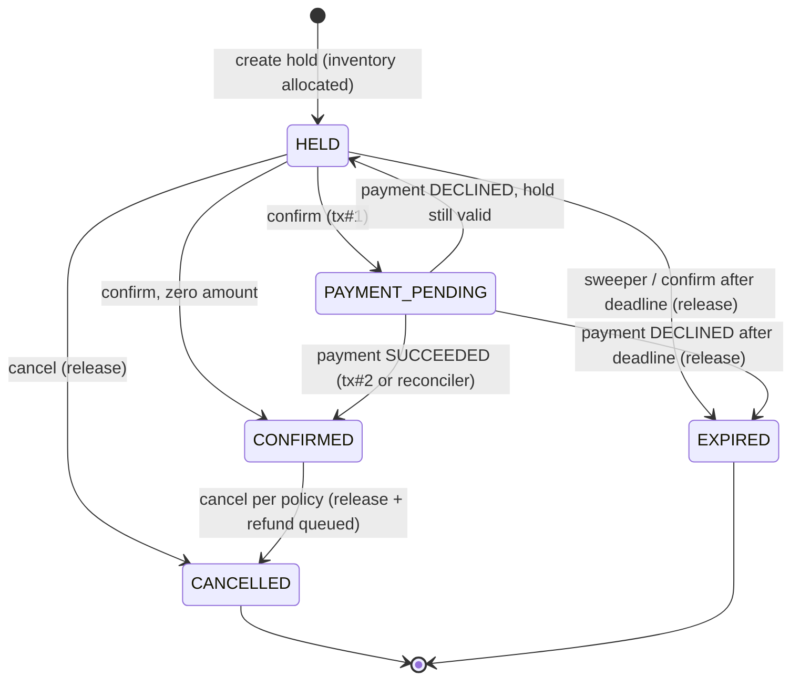
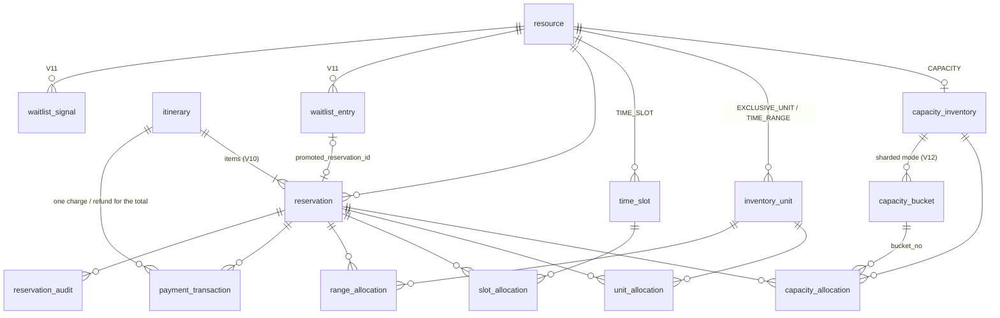
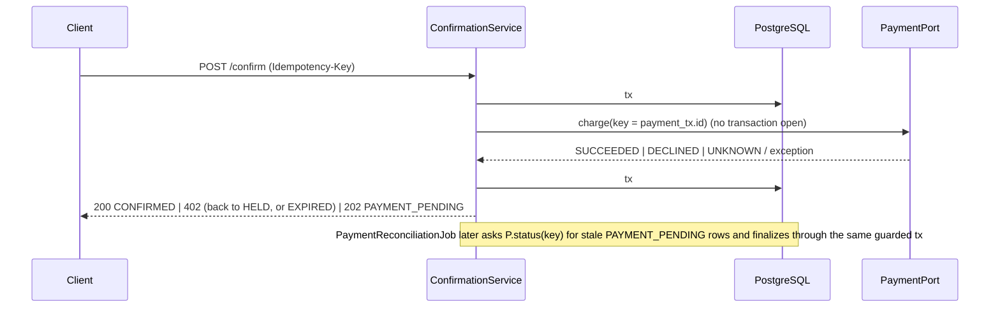

# Architecture: Reservation Engine

## 1. Goals and shape

- **One workflow for every resource type.** Hold → confirm (payment) → cancel, plus expiry. Flights, hotel rooms,
  buses, trains, event tickets, vehicles and appointments only differ in *how inventory is modelled* and in a few
  *policies*.
- **Modular monolith.** Packages have clear dependencies (`api → application → domain`; `application → SPIs`;
  implementations depend on SPIs, never the reverse). One deployable and one database, so transactions stay simple.
- **SOLID, kept small.** Strategy + Registry for inventory models, a table-driven state machine, policies injected by
  composition, and ports for payment and event publishing. No inheritance hierarchies for resource types.

```
api ──► application ──► domain (Reservation, Itinerary, state machine, policies, Money)
 │           │   HoldExecutor (the only place a HELD reservation is created; reused by
 │           │   single reservations, itineraries and waitlist promotion)
 │           ├──► resourcetype.ResourceTypeDefinition    (SPI #1) ◄── built-ins, config types, extensions.vehicle
 │           ├──► inventory.spi.InventoryStrategy        (SPI #2) ◄── capacity (single row | sharded) / unit / slot / range
 │           ├──► inventory.spi.InventoryReleaseListener (SPI #5) ◄── waitlist.WaitlistSignals
 │           ├──► payment.PaymentPort                    (SPI #3) ◄── FakePaymentAdapter
 │           ├──► outbox.EventPublisher                  (SPI #4) ◄── LoggingEventPublisher
 │           ├──► idempotency, persistence (JPA + JDBC)
 │           └──► observability (metrics, correlation id)
 └──► waitlist (join / cancel, WaitlistPromoter job) ──► application.HoldExecutor
```

## 2. Extension contracts

| Contract | Purpose | Resolved by | Default implementations |
|---|---|---|---|
| `ResourceTypeDefinition` | Type code → inventory model; optional hold TTL, billing period, cancellation policy, attribute and request validation hooks | `ResourceTypeRegistry` (all beans + `reservation.custom-resource-types`) | FLIGHT, TRAIN, EVENT_SEAT (EXCLUSIVE_UNIT); BUS, EVENT_GA (CAPACITY); HOTEL_ROOM (TIME_RANGE); APPOINTMENT (TIME_SLOT); VEHICLE (extension); PARKING_SPOT (config) |
| `InventoryStrategy` | Owns its schema and concurrency technique: `addInventory`, `validateRequest`, `billableUnits`, `allocate`, `release` (idempotent), `availability`; optional `lockOrderRank()` (default 0) used to order items inside an itinerary transaction | `InventoryStrategyRegistry` keyed by `model()` (no switch statements) | CAPACITY (single row or N buckets), EXCLUSIVE_UNIT, TIME_SLOT, TIME_RANGE |
| `InventoryReleaseListener` | Notified inside the releasing transaction whenever a reservation's inventory is given back (cancel, expiry, decline after deadline) | all beans, injected into `InventoryAllocator` | `WaitlistSignals` (writes a waitlist signal row only if someone is waiting) |
| `HoldTtlPolicy` | Hold duration per type | single bean (`@ConditionalOnMissingBean`) | `DefaultHoldTtlPolicy` (type override → default, capped at max) |
| `CancellationPolicy` | Allowed? Refund amount? | `PolicyResolver`: type override → default bean | `DefaultCancellationPolicy`, `VehicleCancellationPolicy` |
| `PaymentPort` | charge / refund / status, idempotent on key | single bean | `FakePaymentAdapter` |
| `EventPublisher` | Deliver outbox events | single bean | `LoggingEventPublisher` |

Registries **fail fast at startup** if a type refers to an unknown model or if two types or strategies collide.
Resources and reservations **snapshot** `type_code` and `inventory_model`, so reconfiguring types later never
changes how existing reservations are released.

## 3. Domain model and lifecycle

`Reservation` is the aggregate root. Every status change goes through `ReservationStateMachine`
(an EnumMap transition table) and is recorded as a `StateTransition`. In the same transaction,
`ReservationEventRecorder` turns each transition into an **audit row** (`reservation_audit`) and an
**outbox event** (`outbox_event`).



`PAYMENT_PENDING` cannot be cancelled or expired. While money may be moving, only a payment outcome can resolve it.

`Itinerary` (V10) reuses **the same** `ReservationStatus` enum and `ReservationStateMachine`: it is "a reservation of
reservations". Its items are ordinary `Reservation` rows with `itinerary_id` set, and every itinerary step applies the
same transition to the itinerary and to each item (`ItineraryLifecycle`), so item audit rows and events are produced
by the existing recorder. `WaitlistEntry` (V11) has its own tiny lifecycle: `WAITING → PROMOTED | EXPIRED | CANCELLED`
(all terminal).

## 4. Schema (Flyway V1..V12)

Resource identity, inventory, allocations, reservations and payments are kept in separate tables.



| Migration | Contents | Key constraints and indexes |
|---|---|---|
| V1 | `btree_gist`, `resource` | CHECK price ≥ 0, ISO currency regex, code format; idx (type_code, created_at) |
| V2 | `reservation`, `reservation_audit` | CHECK status enum, quantity > 0, amount ≥ 0, ends > starts, CONFIRMED ⇒ confirmed_at; idx (user_id, created_at); **partial** idx hold_expires_at WHERE HELD; partial idx WHERE PAYMENT_PENDING |
| V3 | `capacity_inventory`, `capacity_allocation` | CHECK `0 ≤ reserved ≤ capacity`; unique active allocation per reservation |
| V4 | `inventory_unit`, `unit_allocation` | UNIQUE (resource_id, unit_code); **partial unique** (unit_id) WHERE status = 'ACTIVE' |
| V5 | `time_slot`, `slot_allocation` | CHECK ends > starts, `0 ≤ reserved ≤ capacity`; UNIQUE (resource_id, starts_at) |
| V6 | `range_allocation` | `period tstzrange` `[)`; **EXCLUDE USING gist (unit_id WITH =, period WITH &&) WHERE status = 'ACTIVE'** |
| V7 | `payment_transaction` | CHECK type and status enums; partial unique: one SUCCEEDED CHARGE per reservation; partial idx unresolved |
| V8 | `idempotency_record` | **UNIQUE (user_id, idem_key)**; CHECK COMPLETED ⇒ response_status |
| V9 | `outbox_event` | partial idx (created_at) WHERE PENDING |
| V10 | `itinerary`; `reservation.itinerary_id`; `payment_transaction.itinerary_id` | CHECK status enum, 1–20 items, amount ≥ 0, CONFIRMED ⇒ confirmed_at; partial idx WHERE HELD / PAYMENT_PENDING; the reservation HELD-expiry index becomes `WHERE status='HELD' AND itinerary_id IS NULL`; payments: `reservation_id` now nullable with **CHECK num_nonnulls(reservation_id, itinerary_id) = 1** and a partial unique "one SUCCEEDED CHARGE per itinerary" |
| V11 | `waitlist_entry`, `waitlist_signal` | CHECK status enum, quantity > 0, expires > requested, PROMOTED ⇒ promoted_reservation_id; **FIFO partial index (resource_id, requested_at, id) WHERE WAITING**; partial unique `promoted_reservation_id`; partial idx pending signals |
| V12 | `capacity_inventory.bucket_count`, `capacity_bucket`, `capacity_allocation.bucket_no` | per bucket **CHECK reserved ≤ capacity**; FK allocation → (resource_id, bucket_no); unique active allocation becomes (reservation_id, coalesce(bucket_no, -1)); **deferred constraint triggers** enforce `sum(bucket.capacity) = capacity_inventory.capacity` (they only fire on capacity changes, never on the hot `reserved` updates) |

Money is stored as `numeric(19,4)` plus an ISO-4217 code. In Java it is the `Money` record (BigDecimal, scale
normalised to the currency's minor units). All timestamps are `timestamptz` / `Instant`, and Hibernate uses
`jdbc.time_zone=UTC`.

## 5. Core flows

### Create hold: one short transaction
All holds (single reservations, itinerary items, waitlist promotions) go through `HoldExecutor`:
`plan()` (validate + price + TTL, no writes) and `execute()` (persist + allocate + audit/outbox, inside the
caller's transaction).

1. Load the resource, resolve its `ResourceTypeDefinition` and `InventoryStrategy`, and run validation (the strategy's, then the type's).
2. Price = `resource.price × strategy.billableUnits()`. TTL comes from `HoldTtlPolicy`.
3. `saveAndFlush` the HELD reservation (allocation rows reference it through a foreign key).
4. `strategy.allocate(...)`. Any failure rolls back the allocation, the reservation, the audit row and the outbox
   event together. ITs verify that a partial multi-unit failure leaves nothing behind.

### Confirm: no DB lock is held during the payment call



- The payment idempotency key is the `payment_transaction.id`, so provider-side retries are safe.
- Exceptions and timeouts count as **UNKNOWN**. They never count as declined, because the money may have moved.
- A charge that succeeds after the hold deadline still confirms. Its inventory was never released, because the
  sweeper ignores PAYMENT_PENDING.

### Cancel
One transaction: row lock, check the `CancellationPolicy`, transition through the state machine, call
`strategy.release` (idempotent), then audit and outbox. Cancelling a CONFIRMED booking with a refund due inserts a
`REFUND` row as PENDING. The reconciliation job executes it outside any transaction and emits `ReservationRefunded`.

### Expiry sweeper
`SELECT ... WHERE status='HELD' AND hold_expires_at <= now ORDER BY hold_expires_at LIMIT n FOR UPDATE SKIP LOCKED`,
then expire, release and record. Batches commit separately. Several instances can run in parallel safely.

### Itinerary: atomic multi-resource booking

`POST /api/v1/itineraries` takes 1–10 items (configurable, DB allows 20); each item has exactly the single-reservation
request shape.

```mermaid
sequenceDiagram
    participant C as Client
    participant API as ItineraryController
    participant S as ItineraryService
    participant H as HoldExecutor
    participant DB as PostgreSQL
    C->>API: POST /itineraries (Idempotency-Key, items[])
    API->>API: LockConflictRetry (max 3 whole attempts, only on deadlock / lock timeout)
    API->>DB: idempotency claim (own committed tx)
    API->>S: hold(items)  -- ONE transaction, also stores the COMPLETED idempotency marker
    S->>H: plan(item) for every item: validate, price, TTL (no writes)
    S->>S: same currency? total = sum; deadline = now + min(item TTL)
    S->>DB: INSERT itinerary (HELD)
    loop items sorted by (lockOrderRank, resource id, start, slot, unit codes)
        S->>H: execute(item, deadline, itineraryId)
        H->>DB: INSERT reservation(itinerary_id), strategy.allocate(...), audit + outbox
    end
    alt any item unavailable
        S-->>API: InventoryUnavailable → whole tx rolls back (no itinerary, no reservation, no allocation, claim released)
        API-->>C: 409
    else all held
        S->>DB: outbox ItineraryHeld; COMMIT
        API-->>C: 201 itinerary + items (all HELD, same holdExpiresAt)
    end
```

- **All or nothing** is simply one database transaction; no compensation logic.
- **Deadlock avoidance**: every itinerary allocates its items in the same global order. Strategies whose allocation
  locks a shared hot row (CAPACITY, TIME_SLOT counters) report `lockOrderRank() = 1`, so those locks are taken
  **last** and held for the shortest time. Two items on the same unit resource
  could still interleave unit locks in theory; PostgreSQL then aborts one transaction (40P01) and
  `LockConflictRetry` re-runs the whole attempt (claim + transaction); the same happens on a lock timeout (55P03).
  In the concurrency tests and benchmark runs no deadlock was recorded (`pg_stat_database.deadlocks` delta 0). Lock
  timeouts can still happen when a big connection pool queues on one hot row; those are retried the same way
  (`LockTimeoutTranslationIT` covers the 409 mapping).
- **Confirm** (`/itineraries/{id}/confirm`): exactly the single-reservation pattern with ONE payment for the total:
  tx#1 locks the itinerary row then its items (id order), moves all to PAYMENT_PENDING and inserts one itinerary
  CHARGE; the provider is called with no transaction open; tx#2 (`ItineraryPaymentFinalizer`) applies the outcome
  to the whole unit (CONFIRMED, back to HELD, or EXPIRED + release). UNKNOWN outcomes are resolved by
  `ItineraryJobs.reconcile`.
- **Cancel**: every item's `CancellationPolicy` must allow it (otherwise nothing is cancelled); refunds of
  confirmed items are summed into ONE itinerary REFUND processed by the existing reconciliation job (event
  `ItineraryRefunded`).
- **Expiry**: `ItineraryJobs.sweepExpired` claims lapsed HELD itineraries with `FOR UPDATE SKIP LOCKED` and expires
  itinerary + items together. Items are excluded from the per-reservation sweeper and reconciler
  (`itinerary_id IS NULL`), and `/reservations/{id}/confirm|cancel` return **409 MANAGED_BY_ITINERARY** for items.
- **Lock order everywhere** for itinerary commands: itinerary row first, then item rows by id.

### Waitlist with auto-promotion

```mermaid
sequenceDiagram
    participant U as User
    participant W as WaitlistService
    participant R as Release path (cancel / expiry / declined)
    participant DB as PostgreSQL
    participant P as WaitlistPromoter (any number of instances)
    U->>W: POST /waitlist (Idempotency-Key, same shape as a hold)
    W->>DB: validate like a hold; INSERT waitlist_entry WAITING; INSERT signal JOINED; outbox WaitlistJoined
    R->>DB: release inventory + InventoryReleaseListener: INSERT signal RELEASED (only if someone waits) -- same tx
    loop every second
        P->>DB: tx A: claim oldest pending signal FOR UPDATE SKIP LOCKED, mark it and other unlocked signals of that resource processed
        P->>DB: read WAITING entries FIFO (requested_at, id), not expired
        loop each candidate (own short tx B, REQUIRES_NEW)
            P->>DB: SELECT entry ... WHERE status='WAITING' FOR UPDATE SKIP LOCKED
            P->>DB: HoldExecutor: hold as the entry's user (normal TTL)
            alt inventory available
                P->>DB: entry → PROMOTED(reservation id) + outbox WaitlistPromoted; COMMIT B
            else unavailable
                P->>DB: ROLLBACK B (entry stays WAITING)
            end
        end
        P->>DB: COMMIT A (signal processed only after the promotions it triggered were attempted)
    end
    U->>U: GET /waitlist/{id} → promotedReservationId → POST /reservations/{id}/confirm
```

- **Reliability**: the signal is written in the same transaction as the release, so a committed release always
  leaves a signal and a rolled-back one never does (a dedicated mini-outbox). A crash before tx A commits just
  leaves the signal pending. A low-frequency `rescan` job re-signals every resource that still has waiters
  (covers the narrow race of a release committing concurrently with a join).
- **Exactly once**: the hold and the `PROMOTED` mark commit in one transaction while the entry is row-locked and
  still WAITING; `ux_waitlist_promoted_reservation` backs it up. How many waiters can be promoted is decided by the
  inventory strategy itself (conditional update / constraints), so one released seat yields at most one promotion
  regardless of how many promoters race. Tested with 6 promoter threads + 5 concurrent releases, and with 8
  promoters on one release.
- **Ordering**: FIFO by `requested_at` for a single promoter. It is "next eligible", not strict head-of-line: an
  entry whose request cannot be satisfied (e.g. wants 3, 1 was freed, or wants a specific seat) is skipped and
  stays WAITING. With several promoters running concurrently, entries being processed by one promoter are skipped
  by the others, so promotion order can deviate by the number of in-flight attempts.
- **Expiry**: entries expire at `min(now + maxWait, startsAt)` (default 24 h, max 7 d); the expiry job uses
  `FOR UPDATE SKIP LOCKED`. Requests that can never be satisfied any more (resource deactivated, start passed)
  are expired with `last_error`.
- **Cost when nobody waits**: the listener's insert is `INSERT ... SELECT ... WHERE EXISTS (WAITING entry)`, so a
  release without waiters adds one cheap index probe (tested: no signal rows written).

### Flash-sale mode: sharded CAPACITY

`inventory.buckets = N` (1–1024) at first provisioning splits the counter into N `capacity_bucket` rows (capacity
spread evenly; top-ups are spread too; the layout cannot change later, 422). The parent row's `reserved` is not
touched in this mode (that is the point); availability is the sum of the buckets.

1. **Non-blocking fit**: a single `UPDATE ... WHERE bucket_no = (SELECT ... ORDER BY rotation-from-random-start
   LIMIT 1 FOR UPDATE SKIP LOCKED)` takes the whole quantity from the first unlocked bucket that fits.
2. **Blocking fit**: if every fitting bucket was busy, wait on them in ascending bucket order.
3. **Split**: if no single bucket fits, take `LEAST(need, free)` from buckets in ascending order (one allocation row
   per bucket); fail fast without locks when `sum(free) < need`.

Release flips the allocation rows and gives the quantity back to each **source bucket** (ascending order).
Steps 1 and 2 run inside savepoints that are rolled back on a miss: PostgreSQL keeps the lock on a row that was
locked but failed the statement's re-check, and those stray locks produced real deadlocks in the first version of
`ShardedCapacityIT` (fixed; documented in the class). Correctness does not depend on the algorithm: the
per-bucket CHECK plus the sum trigger make overselling impossible at the database level.

## 6. Concurrency approach per inventory model

| Model | Technique | Why |
|---|---|---|
| **CAPACITY** | A single atomic conditional `UPDATE capacity_inventory SET reserved = reserved + :q WHERE resource_id = :r AND reserved + :q <= capacity`. 0 rows means sold out. The CHECK constraint is the last line of defence. **Optional sharded mode**: N bucket rows (see "Flash-sale mode" above) | No read-modify-write and no retries. The row lock lasts only for the short hold transaction, but every hold on the resource serialises on it; buckets remove that serialisation (2.9–6.4× more holds/s at 50–100 threads in the dev-box benchmark, docs/PERFORMANCE.md) |
| **EXCLUSIVE_UNIT** | Explicit units: `SELECT ... FOR UPDATE` on the requested units **ordered by id** (no deadlocks), check for active allocations, insert. Any-N: `FOR UPDATE OF u SKIP LOCKED` on free candidates, insert each inside a **savepoint**. **Partial unique index** on the active allocation per unit as the backstop | Specific seats get exact errors. "Any seat" never blocks behind other buyers |
| **TIME_SLOT** | The same conditional `UPDATE` as CAPACITY, scoped to one slot row (`AND starts_at > now`) | Slots are small counters |
| **TIME_RANGE** | **Exclusion constraint** `EXCLUDE USING gist (unit_id WITH =, period WITH &&) WHERE status='ACTIVE'` guarantees no overlap. Writers also take a short **row lock on the unit** before inserting. Any-unit requests: pass 1 locks free candidates with `SKIP LOCKED`, re-checks, inserts in a savepoint; only if that falls short, a savepoint rollback drops its locks and a second, waiting pass runs in unit-id order | Without the unit lock, two transactions inserting overlapping periods can both place index entries and then wait on each other in the exclusion check (PostgreSQL deadlock; `ConcurrencyIT` hit this). The waiting-only version convoyed every request onto the lowest free room; the SKIP LOCKED first pass doubled any-room throughput in the benchmark |

Cross-cutting:
- **State changes** take `SELECT ... FOR UPDATE` on the reservation row (`findByIdForUpdate`), and `@Version`
  serves as an optimistic backstop. The sweeper uses `SKIP LOCKED`, so a reservation that confirm or cancel holds
  locked is never expired underneath it. Once that holder commits, the row is no longer HELD.
  **Confirm vs expire:** both paths lock the row and check the status. Exactly one wins; tested with randomised
  deadlines.
  **Cancel vs confirm:** cancel either wins from HELD (confirm then fails with 409), or it is rejected while
  PAYMENT_PENDING, or it runs after CONFIRMED and queues a refund. Tested.
- All connections set `lock_timeout = '5s'` (Hikari `connection-init-sql`), so a stuck lock surfaces as a 409 instead of hanging.
- `SavepointTemplate` uses the transaction-bound JDBC connection. A constraint violation on one candidate is rolled
  back locally instead of aborting the whole PostgreSQL transaction.

## 7. Idempotency design

- Applies to the `Idempotency-Key` header on create, confirm and cancel (reservations and itineraries) and on
  waitlist join/cancel. The key is required: 8–255 characters of `[A-Za-z0-9._:-]`.
  Scope is **(user, key)**, so different users never collide.
- `request_hash` = SHA-256(operation ‖ target id ‖ canonical JSON of the body, with sorted properties and map keys).
- Algorithm:
  1. **Insert first.** `INSERT ... ON CONFLICT (user_id, idem_key) DO NOTHING RETURNING id`, committed in its own
     transaction. The unique constraint lets exactly one concurrent request win. The others block on the index
     entry until the winner's claim commits, then see the row.
  2. Existing row: a different hash or operation → **422**. `IN_PROGRESS` → **409**. `COMPLETED` → replay the
     stored status and body with `Idempotent-Replayed: true`.
  3. The winner executes. For **create and cancel (ATOMIC mode)**, the business effect and the `COMPLETED` marker
     with the stored response commit in **the same transaction**, so no window exists where the effect is visible
     but the key isn't completed. **Confirm (SEPARATE mode)** spans several transactions by design. Its completion
     is stored afterwards, which is safe because confirm is idempotent by state: an already CONFIRMED reservation
     returns 200, and a PAYMENT_PENDING one returns 409.
  4. On failure the claim is **deleted**. The failed attempt had no effect (its transaction rolled back), so a retry may run again.
  5. If an owner crashes, its `IN_PROGRESS` claim becomes stale after `in-progress-timeout` (2 min) and a retry with
     the **same** hash may take it over. Records expire after 24 h and are purged hourly.
- Tested: 20 concurrent identical requests produce exactly one reservation, and every success response carries the
  same id. With conflicting payloads under one key there is still exactly one effect, and the losing payload later
  gets a 422.

## 8. Outbox, audit and observability

- **Outbox.** Events are written by `OutboxWriter` (`Propagation.MANDATORY`) in the business transaction.
  `OutboxPublisherJob` claims PENDING rows with `FOR UPDATE SKIP LOCKED`, publishes through `EventPublisher`, and
  marks them SENT. After 10 failed attempts a row becomes FAILED. Delivery is at-least-once.
- **Audit.** `reservation_audit` stores from, to, actor, reason, correlation id and timestamp for every transition.
- **Correlation.** `CorrelationIdFilter` (highest precedence) accepts a safe `X-Correlation-Id` or generates one,
  puts it in the MDC, echoes it in the response, and adds it to every ProblemDetail.
- **Logging.** The default is key=value lines (`corr=` included). The `json` profile switches to Logstash JSON encoding.
- **Metrics (Micrometer).** Counters `reservation.holds`, `reservation.conflicts`, `reservation.confirms{outcome}`,
  `reservation.expiries`, `reservation.cancellations`, `reservation.idempotency.replays`, `itinerary.holds{result}`,
  `itinerary.confirms{outcome}`, `itinerary.expiries`, `waitlist.events{event}`; timers
  `reservation.hold.duration`, `reservation.confirm.duration`, `itinerary.hold.duration`,
  `itinerary.confirm.duration`. Exposed through `/actuator/prometheus` (ADMIN).
- **Events added**: `ItineraryHeld/PaymentPending/Confirmed/Cancelled/Expired/Refunded` (aggregate `Itinerary`),
  `WaitlistJoined/Promoted/Expired/Cancelled` (aggregate `WaitlistEntry`). Item reservations keep emitting their
  normal `Reservation*` events.
- **Health.** DB plus a custom `outbox` indicator (pending and failed counts), and liveness/readiness probes.

## 9. Security

A stateless OAuth2 resource server. HS256 key from `JWT_SECRET` (startup fails if it is missing or shorter than 32
bytes), with optional issuer validation. `roles` claim → `ROLE_*`; `sub` = user id. ADMIN is required for every
resource or inventory write (URL rules plus `@PreAuthorize`) and for metrics. The application layer enforces
ownership (`AccessPolicy`): users can only reach their own reservations (403), while admins can reach any.
401 and 403 responses from the filter chain are also RFC 7807.

## 10. Persistence notes

- JPA for aggregates (`Resource`, `Reservation`, `PaymentTransaction`, `OutboxEvent`, audit). Plain JDBC
  (`NamedParameterJdbcTemplate`) for inventory and idempotency, where atomic conditional SQL, ranges and `RETURNING`
  matter. Both share one transaction through `JpaTransactionManager`.
- `ddl-auto=validate` (Flyway owns the schema) and `open-in-view=false`.
- N+1 avoidance: `join fetch r.resource` with a separate count query for reservation lists and detail views. Type
  and model are denormalised onto the reservation, so the sweeper and release paths never load the resource.

**JDBC exception translation.** Spring 6's default `JdbcTemplate` translator does not map PostgreSQL's 55P03
(lock timeout) to `CannotAcquireLockException`, because the driver does not throw JDBC 4 subclasses. The benchmark
exposed this as HTTP 500s. `JdbcExceptionTranslationConfig` installs the SQL-error-code translator so JDBC and JPA
paths both yield `PessimisticLockingFailureException` → 409 / whole-transaction retry (`LockTimeoutTranslationIT`).

## 11. Key trade-offs

| Decision | Benefit | Cost |
|---|---|---|
| Model-specific tables per strategy | Real DB constraints per model (CHECK, partial unique, EXCLUDE) | A new model needs a migration |
| JPA annotations on domain entities | Less mapping code | Domain is not persistence-ignorant |
| Payment outside the DB transaction, plus PAYMENT_PENDING | No locks or connections held across network calls. Uncertain outcomes are explicit and reconciled | Extra state and a reconciliation job. Clients must handle 202 |
| SKIP LOCKED for "any unit" | No convoying under contention | Can report "unavailable" while another transaction holds the last unit and later rolls back (a false negative, never an oversell) |
| Unit row lock for TIME_RANGE | No exclusion-check deadlocks | Serialises writers per unit, even for non-overlapping periods (the transactions are short) |
| Idempotency claim committed separately | Concurrent duplicates get a fast 409 | Stale claims need the takeover rule (implemented) |
| Failed attempts delete their claim | Clients can retry after a 409 sold-out or 402 | Error responses are not replayed |
| Fake payment adapter in-memory | Deterministic tests and local runs | Its settled-state map is per process (fine for a fake) |
| Polling outbox publisher | Simple, no extra infrastructure | Up to `poll-interval` of latency. At-least-once delivery |
| Itinerary = one DB transaction | True atomicity with zero compensation code; reuses every strategy unchanged | The transaction holds locks on all items' inventory at once; a hot counter in an itinerary limits itinerary throughput (mitigated by lock rank, solved by buckets) |
| Itinerary items are plain reservations | No second lifecycle, audit or event model | Item endpoints need a guard (409 MANAGED_BY_ITINERARY) and the per-reservation jobs filter `itinerary_id IS NULL` |
| Waitlist promotion via signal table + polling promoter | Exactly-once with plain SQL, safe with many instances, no broker | Up to `promote-interval` (1 s) promotion latency; "next eligible" rather than strict head-of-line |
| Sharded capacity | Removes the single hot row; DB-enforced invariant | Sell-out of the last units may need a split across buckets (more statements); bucket count fixed at provisioning; availability read sums N rows |
| SKIP LOCKED + savepoint in hot paths | No convoying, no stray-lock deadlocks | Extra SAVEPOINT/RELEASE round trips per allocation |

## 12. Known limitations

- Availability endpoints are non-locking snapshots, so a hold can still lose the race (409 is the source of truth).
- Refunds only run through the reconciliation job (no immediate attempt after commit). A refund the provider
  rejects is marked FAILED and needs operator action. No partial or multi-currency payments.
- Replayed idempotent responses restore status and body, but not headers such as `Location`.
- Resource updates and deactivation are not exposed over REST (there is `Resource.deactivate` in the domain only),
  and neither are unit or slot removal.
- `LoggingEventPublisher` and `FakePaymentAdapter` are stand-ins. Real broker and PSP adapters have to be written.
- The TIME_SLOT availability window defaults to 30 days and 500 slots per query.
- Itineraries: single currency only; no partial confirmation or per-item modification; an itinerary's deadline is
  the shortest item TTL; no item-level refund policy aggregation beyond summing.
- Waitlist: no priority tiers; FIFO is best-effort with concurrent promoters (see above); promotion latency is bounded
  by the poll interval; a promoted hold that the user never confirms simply expires (and releases to the next waiter).
- Sharded capacity: the bucket count is cached per resource in memory (it is immutable once provisioned); the cache
  is unbounded, which is fine for thousands of resources but should become an LRU for millions.
- `LockConflictRetry` wraps only the itinerary create endpoint; other endpoints surface a deadlock/lock timeout as 409.
- Auth is a shared HS256 secret. A real deployment should validate tokens from an IdP via JWKS (only the
  `JwtDecoder` bean changes).
- No rate limiting or per-user quotas; that is expected to live in a gateway in front of the service.
- Domain entities carry JPA annotations, so the domain package is not framework-free (ArchUnit only keeps Spring out).
